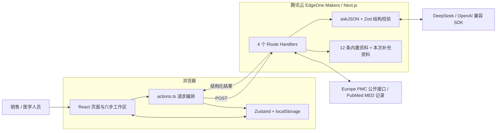
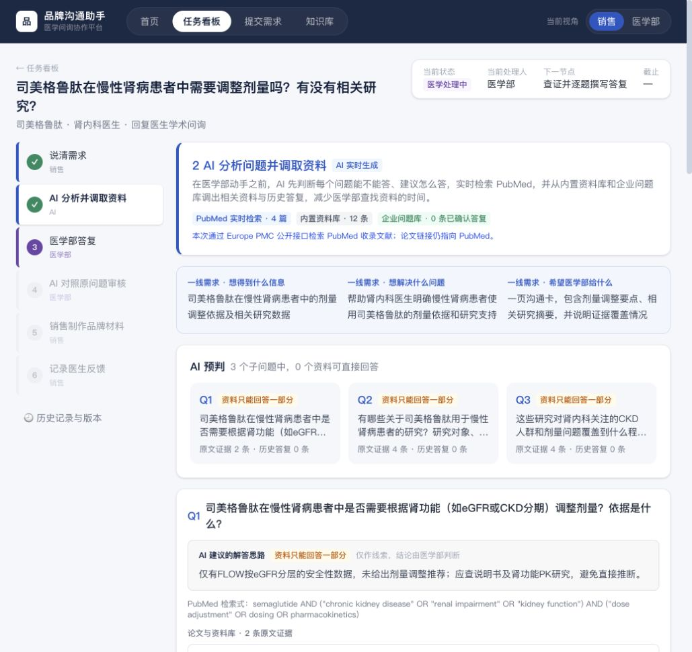

# 品牌沟通助手 · Brand Assistant

苏州黑客松项目。帮助药企一线代表与医学部协作处理医学问询：销售说清需求，AI 准备问题与证据，医学人员完成专业答复，AI 再辅助检查遗漏，销售据此制作沟通材料并记录反馈。

**[在线正式版](https://soochowhackathon261101.noiamist.com) · [系统架构](docs/ARCHITECTURE.md) · [运行与部署](docs/GETTING_STARTED.md) · [实际验收](docs/verification.md) · [材料索引](docs/MATERIALS.md)**

## 先看哪些内容

| 想了解什么 | 阅读入口 |
|---|---|
| 系统怎样工作、哪些数据经过模型 | [架构与数据流](docs/ARCHITECTURE.md) |
| 关键代码在哪里 | [源码导航](docs/ARCHITECTURE.md#源码导航) |
| 本地运行、环境变量、腾讯云托管 | [运行与部署](docs/GETTING_STARTED.md) |
| 产品目标、角色责任与设计推演 | [产品设计 v3](docs/product-design/医学问询产品设计_v3.md) |
| 演示视频、路演 PPT、历史截图 | [路演材料](materials/pitch/README.md) |
| 正式版真实检索做了哪些检查 | [验收记录](docs/verification.md) |
| 历史演示版、旧部署方案和制作工具 | [全部材料索引](docs/MATERIALS.md) |

## 架构概览



技术栈：Next.js 16、React 19、TypeScript、Tailwind CSS 4、Zustand、Zod。AI 调用位于服务端；模型默认值为 `deepseek-flash`。论文入口默认使用 Europe PMC，限定 PubMed 收录记录，并显示真实 PMID、DOI、出处及检索入口。

## 当前业务流程

1. 销售录入医生原话，补充并确认“要什么信息、解决什么问题、希望医学部给什么”。
2. AI 生成英文检索式，检索真实论文摘要，结合内置资料与已确认历史答复提供线索。
3. 医学人员查证、补充资料并逐题撰写答复。
4. AI 对照原问题检查遗漏，医学人员处理提示并确认答复版本。
5. 销售基于确认答复制作沟通卡，保留来源和限制。
6. 销售记录交付、反馈与经验，确认后的知识在当前浏览器中复用。

## 实现范围与实测边界

正式版没有预置任务，也没有“载入模拟医学答复”入口。示例按钮只填入表单，用户仍需提交。医学结论由医学人员负责。

2026-11-01 的线上验收覆盖了两组问题从提交到证据分析的流程：GLORY-1 原始论文 PMID **40421736** 被实时返回并引用；司美格鲁肽与慢性肾病的独立问题也返回了实时文献。两组均显示“AI 实时生成”，并在 40 秒内观察到完成。[详细证据](docs/verification.md)

后续医学答复、完整性检查、材料和反馈有对应代码；本轮线上验收按部署指令止于第 2 步。历史视频包含模拟角色与预置样稿，不能当作真实医学人员验证。

**当前数据保存在浏览器本地。** 角色切换是前端视角切换；当前没有登录系统、组织权限或共享数据库。跨浏览器、跨设备不会同步任务，清理浏览器数据会影响本地记录。



## 本地开始

```sh
npm ci
cp .env.example .env.local
# 在本机填入自己的 DEEPSEEK_API_KEY
npm run dev -- -p 3001
```

打开 [http://localhost:3001](http://localhost:3001)。未配置密钥时，AI 接口会返回并标记离线兜底结果；实时文献接口测试不需要 DeepSeek 密钥。[完整说明](docs/GETTING_STARTED.md)

## 仓库内容

```text
src/                  当前正式版页面、组件、接口和数据类型
scripts/              文献解析测试与完整证据分析探针
docs/                 架构、运行说明、产品设计和正式版验收
materials/pitch/      路演 PPT、历史演示视频和截图归档
tools/                PPT 与演示素材制作脚本
archive/              历史源码快照与旧部署指令
edgeone.json          当前腾讯云托管构建配置
.env.example          空白配置模板，未包含实际密钥
```

当前源码来自已部署的本地 `prod` 提交 `133885f`，以新的 GitHub 历史导入。为了公开展示，仓库 README、架构说明及材料索引作了补充；个人路径与云实例标识已匿名化。原本地正式版和备用演示版没有因本次发布而修改。当前腾讯云仍使用源码包构建；新建此仓库不会自动改变线上部署。

