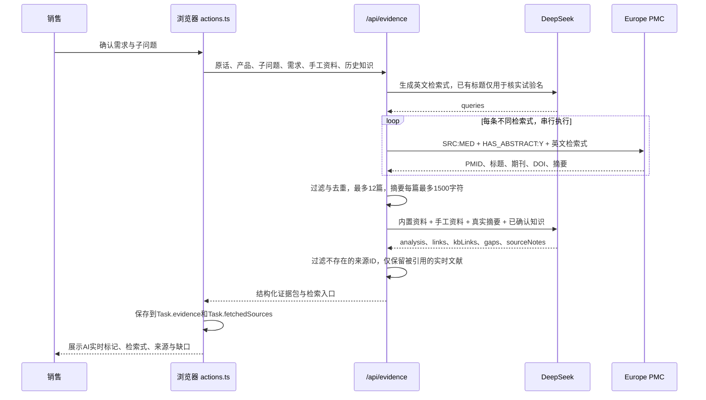
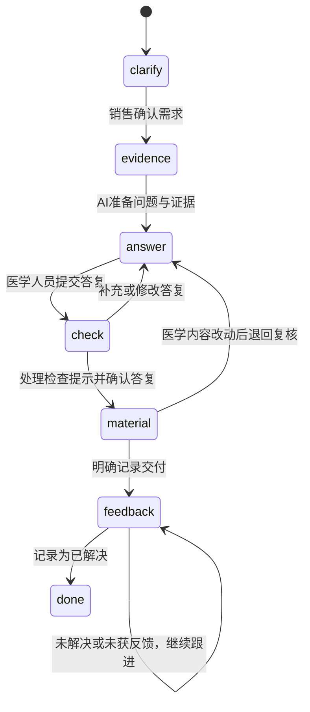
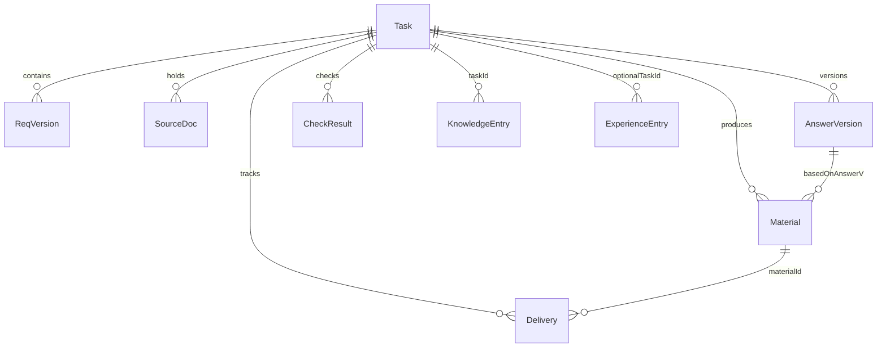

# 系统架构与代码导航

本文对照仓库中的实际代码编写。它描述当前实现，不把产品设计中的后续设想当成已经存在的服务。

## 1. 运行边界

| 层 | 主要职责 | 实现 |
|---|---|---|
| 浏览器页面 | 角色视图、任务工作区、手工医学答复、材料预览 | React Client Components |
| 浏览器状态 | 任务、需求与答复版本、知识、经验、交付反馈 | Zustand persist / localStorage |
| Next.js 服务端 | 接收业务请求、调用模型、检索文献、组织证据 | `src/app/api/*/route.ts` |
| 模型适配 | OpenAI 兼容 SDK、DeepSeek、JSON 输出和 Zod 校验 | `src/lib/llm.ts` |
| 文献适配 | 实时查找 PubMed 收录记录与摘要 | `src/lib/pubmed.ts`，默认 Europe PMC |
| 托管 | 构建页面并运行服务端接口 | 腾讯云 EdgeOne Makers |

服务端接口按请求处理数据。当前没有把 Task 写入云数据库，也没有向量数据库、后台任务队列或独立 Agent 服务。

角色切换只改变前端视图和界面操作条件，不等同于服务端身份认证。当前没有账号、组织授权和跨设备同步。页面发送的原始问题、补充需求、选入摘要或答复，会按不同接口进入模型上下文；当前没有自动去标识化模块。

## 2. 页面与接口

| 页面 | 文件 | 作用 |
|---|---|---|
| `/` | `src/app/page.tsx` | 项目介绍与入口 |
| `/new` | `src/app/(app)/new/page.tsx` | 新建需求，示例只填表 |
| `/tasks` | `src/app/(app)/tasks/page.tsx` | 当前浏览器的任务看板 |
| `/task/[id]` | `src/app/(app)/task/[id]/page.tsx` | 六步工作区和历史记录 |
| `/kb` | `src/app/(app)/kb/page.tsx` | 当前浏览器保存的医学知识、经验与 SOP |

| POST 接口 | 主要输入 | 主要输出 | 代码声明的执行上限 |
|---|---|---|---|
| `/api/clarify` | 原问题与销售补充 | 需求三问、子问题、结果来源 | 60 秒 |
| `/api/evidence` | 产品、原话、子问题、需求、补充资料和历史知识 | 解答线索、来源关联、缺口、检索式、实时文献 | 120 秒 |
| `/api/check` | 原问题、子问题、医学答复 | 有回应 / 资料不足 / 可能遗漏 | 60 秒 |
| `/api/material` | 已确认答复、用途、对象和表达偏好 | 标题、逐题材料段落、注意事项 | 60 秒 |

`askJSON` 使用服务端密钥调用 DeepSeek，通过 JSON 模式与 Zod 检查返回结构。结构不合格时尝试修正，最终失败由各业务接口返回 `source: preset`。界面区分实时与兜底来源。结构校验不构成医学正确性认证。

## 3. 证据分析的完整数据流

关键约束：

- 相同检索式只请求一次；每条返回最多 4 篇，按 PMID 去重，总计最多 12 篇候选。
- 请求在当前服务实例内串行，并保留至少 350 ms 的启动间隔；单次网络请求超时 10 秒。没有实现跨云实例的统一限流。
- Europe PMC 结果必须属于 `MED`，具有数字 PMID、标题和可用摘要。当前只把摘要交给模型，不抓取期刊付费全文。
- `quote` 保持为空，模型只生成中文整理与研究条件。返回的实时文献只保留实际被 `links` 引用的记录。
- `retrievedVia` 记录入口，论文 URL 仍指向 PubMed。不同入口的排序和覆盖可能不同。
- 默认入口为 Europe PMC。保留 NCBI 实现，只有设置 `PUBMED_PROVIDER=ncbi` 才切换；云端曾被 NCBI 要求访问验证，因此当前不自动反复请求该入口。
- 文献检索无结果时继续用已有资料，并明确提示范围；整个 AI 分析失败时使用带来源标记的兜底结果。

## 4. 业务状态与人工确认

专业答复由医学人员录入。AI 完整性检查只对照“有没有回应原问题”，不判断临床结论正确。材料生成通过提示词约束保留已确认事实与边界，不能把这项约束描述成自动医学审定。

`answerHash` 与需求版本用于判断旧检查是否过期。确认答复后，材料记录其依据的答复版本；反馈绑定具体交付和材料版本。新的医学问题通过新建需求继续处理，不把原任务静默改成另一个问题。

## 5. 内存对象关系

下图是 TypeScript 对象与引用关系，**不是已部署的 SQL 数据库**。

| 对象 | 关键关联 |
|---|---|
| `ReqVersion` | 需求三问、子问题、确认状态与版本号 |
| `EvidenceResult` / `EvidenceLink` | 子问题 ID、资料 ID、采用状态、检索式与缺口 |
| `SourceDoc` | PMID 或本任务补充资料编号、出处、摘要整理、适用范围、入口 |
| `AnswerVersion` | 需求版本 `reqV`、人工答复、引用、确认人 |
| `CheckResult` | `reqV`、`answerHash`、逐题结果与处理说明 |
| `Material` | `basedOnAnswerV`、材料版本、段落与限制 |
| `Delivery` | `materialId`、`materialV`、反馈状态、原话和备注 |
| `KnowledgeEntry` | 来源任务与答复版本，有效 / 待复核状态 |
| `ExperienceEntry` | 个人 SOP、表达偏好或经验，可关联原任务 |

上述集合通过 `brand-assistant-prod-v1` 保存到当前浏览器 localStorage。“企业知识库”在这一版也属于本地状态，不是组织共享数据服务。

## 源码导航

- [业务数据类型](../src/lib/types.ts)：对象定义、状态和来源类型。
- [浏览器状态](../src/lib/store.ts)：新建任务、版本更新与持久化。
- [业务请求编排](../src/lib/actions.ts)：四类 AI 请求及结果写回。
- [流程与版本辅助](../src/lib/flow.ts)：当前需求、检查失效判断、资料合并。
- [模型适配](../src/lib/llm.ts)：服务端 DeepSeek 调用与 Zod 校验。
- [文献适配](../src/lib/pubmed.ts)：NCBI XML、Europe PMC MED 解析和请求控制。
- [证据接口](../src/app/api/evidence/route.ts)：检索式、检索、分析与来源过滤。
- [人工医学答复](../src/components/steps/Step3Answer.tsx)：手工答复、补充资料和引用。
- [完整性检查与确认](../src/components/steps/Step4Check.tsx)：逐题处理和答复确认。
- [材料制作](../src/components/steps/Step5Material.tsx)：绑定确认版本与交付。
- [反馈与经验](../src/components/steps/Step6Feedback.tsx)：交付反馈、经验保存。
- [来源卡片](../src/components/Evidence.tsx)：出处、入口、采用与引用展示。

当前实测范围和测试材料的区别见 [验收记录](verification.md)；原始产品方案中的后续功能见 [产品设计 v3](product-design/医学问询产品设计_v3.md)。

