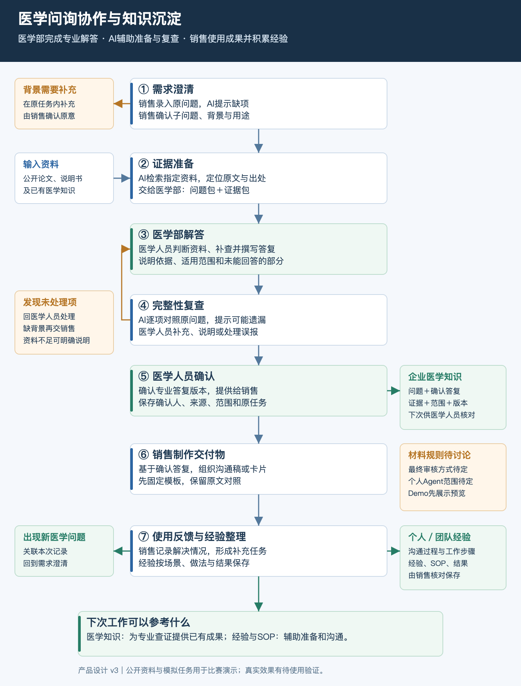

# 医学问询协作与知识沉淀平台

产品设计文档 v3｜团队评审与研发对齐版

日期：2026-10-31。阅读对象：产品、研发、演示负责人及行业顾问。

本版根据最新讨论更新产品方向，替代 v2 中关于专业答复生成主体、流程顺序及知识沉淀优先级的约定。文中区分已确认方向、首版设计建议和待团队讨论事项。当前交付物是产品设计，功能实现与真实使用效果仍需验证。

## 1. 产品目标与已确认方向

为药企一线代表与医学部提供一个内部协作工作台：销售把医生的问题提交进来，AI帮助澄清需求和准备相关证据，医学人员完成专业查证与解答；AI再辅助检查遗漏，销售使用确认后的答复制作沟通材料，最终留下可复用的医学知识和一线经验。

产品要减少三类工作：问题背景反复补问、专业资料反复查找、已完成的答复与经验反复从头整理。是否有效，应观察整个任务的处理时间、医学人员实际用时和返工次数。

以下方向已经确认：

- 医学人员收到的是“整理清楚的问题＋相关证据”，由医学人员查证、撰写并决定专业结论。
- AI辅助需求检查、资料检索、答复完整性检查及材料整理，不承担专业答复的主体角色。
- 销售制作交付物的功能保留；材料最终如何审核、个人Agent可以自由改写到什么程度，继续讨论。
- 企业医学知识和个人／团队经验都属于产品核心沉淀，需要在首版展示基础保存与查找能力。
- 演示使用公开资料、自拟需求和模拟角色操作。真实问询量、专业使用者接受度及节省时间尚未验证。

访谈依据：已获得的从业者描述中，简单问题可在群内较快解决，深入问题需要转交医学部，存在资料查找和沟通往返。受访者主要从协调工作的角度提供信息，对医学部内部工作量并不掌握。因此，本版优先处理需要医学部参与的专业问询。

## 2. 相对上一版，具体改变什么

| 事项 | v2 的安排 | v3 的安排 |
| --- | --- | --- |
| 专业答复主体 | AI准备答复草稿，医学人员核查、修改 | AI提供问题与证据，医学人员完成专业解答 |
| 完整性检查 | 主要放在成品形成和最终审核之前 | 医学人员写出答复后，AI逐项对照原问题 |
| 确认对象 | 最终沟通成品 | 首先确认医学部的专业答复；衍生材料的审核规则待定 |
| 交付物位置 | 专业答复与沟通卡作为两种可选最终成品 | 医学答复是专业成果，销售可继续据此制作交付物 |
| 知识沉淀 | 答复归档为主，其他知识与偏好后续再做 | 首版包含医学知识条目及经验条目的保存、查看和查找 |
| 版本关系 | 一套成品与审核版本 | 区分需求、医学答复、销售材料；材料绑定其依据的答复版本 |

原方案中有用的能力继续作为研发基础：来源可追溯、需求版本、历史记录、关联反馈、真实／预设模式区分和迟到结果保护。上述业务变化应先落实到页面和数据流，再继续扩展功能。

## 3. 角色与责任

| 角色 | 主要工作 | 交出的成果 |
| --- | --- | --- |
| 销售／一线代表 | 记录医生原意，补充背景，确认需求，制作材料，记录使用反馈与经验 | 问题包、沟通材料、反馈与经验条目 |
| 医学人员 | 判断证据适用性，补查资料，撰写答复，处理遗漏，确认专业成果 | 带依据与适用范围的医学答复 |
| AI | 提示问题缺项，检索整理资料，对照问答，辅助组织材料和经验 | 建议、证据候选、完整性检查结果、材料预览 |
| 系统 | 保存版本，展示当前负责人和下一步，记录来源、交付和知识条目 | 可追溯的协作记录 |
| 医生 | 提出问题，对沟通结果提供反馈 | 原始问题和反馈；首版通过代表录入 |

销售确认“问题是否符合医生原意”；医学人员确认“专业内容是否成立、适用于什么范围”；AI给出辅助检查结果。界面分别使用“需求确认”“完整性检查”“医学人员确认”，避免统一叫作“AI审核通过”。

团队用研可以帮助理解场景、提供访谈背景，日常任务默认由销售提交。首版只设置销售与医学人员两个演示角色，角色切换仅用于演示职责。

## 4. 总体流程

主线：需求澄清 → 证据准备 → 医学部解答 → AI完整性复查 → 医学人员确认 → 销售制作交付物 → 使用反馈。

医学答复确认后可先归档；一线经验在沟通与反馈之后补充。两个知识入口都保留原任务关联，供下一次查找与参考。

### 4.1 需求澄清：把问题说清楚

目的：避免医学人员接到缺少背景或理解有偏差的问题。

- 输入：医生原话、已知背景、产品／议题、使用目的；销售可以先提交不完整的信息。
- AI动作：拆分子问题，指出含糊表述，列出影响理解的缺项；优先询问少量关键问题。
- 人的动作：销售补充或向医生确认，核对AI整理是否改变了原意；专业术语不清时请医学人员协助。
- 产出：问题包，包含原话、已确认的子问题、已知背景、未知项和使用目的。
- 交接：销售确认后进入资料准备。补充仍在同一任务内进行，并保存需求版本。
- 例外：信息暂时拿不到，可以明确标为未知交医学人员判断；AI不能自行填成事实。

首版最低输入：原始问题、用途、销售确认的问题清单。产品、角色和受众可以预填，截止时间选填。交付物形式可在销售收到答复后再选。

### 4.2 证据准备：把相关资料送到医学人员面前

目的：减少资料查找和定位时间，为医学人员的查证提供起点。

- 输入：已确认的问题包、指定资料范围、企业中已有的相关医学答复。
- AI动作：按子问题匹配论文、说明书等资料，整理原文位置、出处、日期和资料中描述的研究条件。
- 产出：证据包。每条包括关联问题、资料标题、链接、页码／段落、短原文、可选中文整理和来源版本。
- 交接：医学人员查看并判断，决定采用、排除或补查。找到相关文献不自动等于该文献支持某个结论。
- 例外：没有找到资料时，展示本次资料范围与缺口；有不同结果时同时呈现，交医学人员判断。

首版从预置公开资料中匹配，显示资料范围。摘要、全文片段和中文整理要区分。已有医学答复可以作为线索，其适用性仍由医学人员核对。

### 4.3 医学部解答：完成核心专业工作

目的：由医学人员完成专业判断与答复。

- 输入：问题包和证据包。
- 人的动作：医学人员阅读来源、补充调查、判断证据适用性，逐项写出答复，说明依据、限制和暂时无法回答的部分。
- AI动作：可按医学人员要求继续找资料、定位原文，辅助资料整理。本版不自动起草整份专业答复。
- 产出：医学人员撰写的答复草稿，各答复段落与相应子问题、采用的来源相连。
- 交接：提交完整性检查。医学人员可以直接在页面录入／粘贴内容，首版无需依赖文件解析。
- 退回：缺背景交销售补充；需要补资料留在医学人员的工作任务内，继续查找。

Demo可以提供“载入模拟医学答复”以方便展示，明确标为预置样稿，不能表现为AI自动完成医学工作或真实专家已审核。

### 4.4 AI完整性复查：逐项核对有没有回应

目的：辅助发现遗漏，减少答复返回一线后才发现漏问的情况。

- 输入：当前需求版本和当前医学答复草稿。
- AI动作：对照每个子问题，定位对应答复段落，提示未回应或可能含糊的部分。
- 产出：问题—答复对照表，显示“有对应答复”“已明确说明资料不足”“可能遗漏／需核对”。
- 人的动作：医学人员查看提示，补充答复、明确无法回答的原因，或说明为何该提示不成立。
- 交接：每个子问题都有明确处理结果后，由医学人员确认答复版本。

完整性检查不输出“医学正确率”。AI可能误判遗漏，医学人员可写明理由并处理提示；系统保留记录。明确记录的资料不足可以完成本次答复，未处理的问题不能被静默删掉。

### 4.5 医学人员确认：形成专业成果并归档

目的：确认本次医学答复，并让成果能够被查找和追溯。

- 输入：答复、来源、适用范围和已经处理的完整性检查结果。
- 人的动作：医学人员确认专业内容与处理结果；这是完成本次答复的动作。
- 产出：医学答复确认版本，记录作者／确认人、时间、需求版本、正文和来源。
- 交接一：提供给销售查看和制作交付物。
- 交接二：按明确的归档动作保存为企业医学知识条目；首版可在确认时同步归档。
- 修改：需求或医学正文变化，生成待确认的新版本。旧版及其历史使用记录保留。

后续知识复用仍携带原问题背景和适用范围。下次有类似问询时，先作为相关线索提供给医学人员，不自动继承旧任务的确认。

### 4.6 销售制作交付物：将专业内容组织成可用材料

目的：让销售根据具体沟通需要使用医学部完成的专业内容。

- 输入：已确认的医学答复版本、使用目的和所选形式。
- 人的动作：销售选择沟通稿、FAQ或一页卡片等形式，检查生成结果与原文的对应。
- AI动作：基于给定答复组织材料，保留来源、条件与限制；不自行增添医学结论。
- 产出：独立的销售材料版本，记录所依据的医学答复版本，支持与原文并排查看。
- 首版建议：先提供一个固定沟通卡模板，将已确认段落放入对应栏目，保留关键说明和引用。
- 待定：是否允许自由改写、何时增加材料审核、是否发展个人Agent，列入团队评审议题。

医学部确认的是专业答复，衍生材料不得自动显示“医学部已审核此材料”。Demo可保留生成、预览和模拟交付能力，正式使用前的材料审核方式尚未定案。提示词中的“不得违反原文”是约束目标，其落实效果需要另行验证。

### 4.7 使用反馈：继续跟进，并整理工作经验

目的：记录问题解决情况，并保留一线实践中有用的做法。

- 输入：具体材料、使用时间、沟通情况及医生反馈；Demo先以模拟记录展示。
- 人的动作：销售记录已解决、部分解决、未解决或未获反馈，并区分医生原话与自己的判断。
- AI动作：辅助提取新的问题、工作步骤和经验草稿，交销售核对。
- 产出：绑定本次交付版本的反馈、关联补充任务、个人／团队经验条目。
- 后续路由：新的医学疑问重新进入需求澄清；疑似原答复错误交医学人员复核。

点击生成、预览、复制不自动记为已交付。再次交付新版本时，新建独立记录，初始为未获反馈；旧反馈继续归属于旧交付。

## 5. 两类知识沉淀怎样使用

论文、说明书等是输入资料；工作完成后产生的医学答复与一线经验是两类成果。首版使用同一个知识中心，用两个入口区分。

| 项目 | 企业医学知识 | 个人／团队经验 |
| --- | --- | --- |
| 保存内容 | 问题、背景、确认答复、证据、限制、作者和版本 | 场景、做法、工作步骤、反馈、结果、作者和归属 |
| 谁确认 | 医学人员确认专业内容 | 销售确认自己的经验记录 |
| 保存时点 | 医学答复确认后 | 沟通或工作复盘后 |
| 下次作用 | 找到已有专业成果，供医学人员核对适用性 | 参考之前的准备步骤、沟通方式和跟进安排 |
| 首版能力 | 保存、列表、关键词查找、来源查看、关联原任务 | 保存、编辑、关键词查找、个人／团队标签、关联任务 |

医学知识条目至少有：标题、原问题、背景、答复、来源、适用范围、确认人、确认日期、版本与有效状态。原答复正在复核时，相关条目标为待复核，停止作为可直接参考的已确认内容推荐。

经验条目至少有：场景、采取的动作、观察到的结果、经验说明、作者及原任务。个人偏好、个人SOP、经验案例分别标记。一个人的做法可先保存为个人经验；升级为团队通用SOP的规则由团队后续决定。

知识中心展示的是已确认或由本人确认的条目。原始聊天、生成草稿和个人推测保留其原始状态，不混成已确认医学知识。初版的个人／团队标签用于演示归属，真实组织权限后续实现。

## 6. 页面与日常操作

### 6.1 任务列表

显示问题摘要、提交人、当前处理人、下一步动作、最近更新时间和选填期限。任务负责人默认销售，当前处理人随环节改变。任务状态可简化为：待澄清、资料准备中、医学处理中、完整性待核对、医学答复已确认、材料准备中、等待反馈。

### 6.2 任务工作区

建议四个页签，保持一条任务中连续操作：

1. 问题与证据：原话、已确认子问题、未知项和逐题关联的证据卡。
2. 医学解答：医学人员编辑答复、查看原文、发起完整性检查并确认版本。
3. 材料与反馈：选择已确认答复，生成沟通卡，查看原文对照，记录模拟使用和反馈。
4. 历史记录：需求、答复、材料、确认和交付记录的关联。

销售首页突出“需要我补什么、医学部是否已经回复”；医学人员首页突出“问题是什么、证据在哪里、还有哪项未处理”。

### 6.3 知识中心

包含“医学知识”和“经验与SOP”两个入口。条目可打开原任务及对应版本；在新任务中找到旧内容后，将其作为参考加入，不覆盖当前问题。首版可用本地关键词检索实现可见的复用过程。

## 7. 首版范围与可执行边界

| 优先级 | 内容 | 完成标志 |
| --- | --- | --- |
| P0：主线 | 需求澄清、证据包、医学人员录入答复、逐题对照、医学确认 | 一个任务按角色完整走通，清楚显示谁完成专业工作 |
| P0：材料 | 一个固定沟通卡模板、原文对照、来源答复版本 | 销售能形成材料预览，材料不会冒用专业答复的确认状态 |
| P0：沉淀 | 两类知识条目保存、查看、关键词查找、任务关联 | 能在下一次任务找到之前的答复和经验 |
| P0：反馈 | 模拟交付、四种解决状态、关联新问题 | 反馈对应具体交付，交付与问题解决分别记录 |
| P1 | 更多模板、简单经验整理建议、截止提醒、资料筛选 | 主线完成后再增加 |
| 后续 | 文件自动解析、更多数据库、个人Agent、组织权限、多人同步 | 结合真实使用者和资源继续确定 |

时间紧时，优先简化界面、模板数量和数据量，保留“医学人员解答”和“两类成果沉淀”这两个核心。预置资料与模拟角色可以支撑演示；公开资料原文与自拟工作记录须明确区分。

## 8. 与已有研发的衔接

先核对已有实现，再按以下变化调整。旧版工程计划中与本版冲突的流程不再直接照搬。

- 原有AI生成整份专业答复的主入口，改成医学人员编辑／粘贴答复。模型用于问题澄清、检索辅助与完整性复查。
- 将完整性检查放在医学答复产生之后，绑定需求与答复版本；编辑任一版本后，旧检查结果显示过期。
- 将原“最终成品审核”改为明确的“医学答复确认”。销售材料单独保存，记录所引用的医学答复版本。
- 销售改材料不改变医学答复原文，也不撤销原答复本身的确认；材料应成为新版本并重新标记其检查／审核状态。医学答复修改后，旧材料提示所依据的版本已变化。
- 医学确认后创建或更新医学知识条目；销售确认经验后保存经验条目。历史版本和历史反馈不被覆盖。
- 现有公开证据卡可继续使用；旧版AI答复fixture不能冒充医学人员刚刚完成的工作。演示样稿需单独标记为预置模拟医学答复。
- 保留实时／预设模式标识、引用定位、输入版本、异步结果失效检查和历史快照。

产品数据至少分清八类对象：需求及子问题、来源资料、医学答复、完整性检查、销售材料、交付与反馈、医学知识条目、经验条目。此处定义业务关系，接口与存储字段由研发按现有实现补全。

## 9. Demo演示与验收

### 9.1 一条可展示的主案例

沿用已有公开资料，使用自拟问询：“这项研究纳入什么年龄范围？比较对象是什么？现有资料能否回答另一年龄人群的问题？”问题只用于演示资料范围与问答覆盖，不模拟真实诊疗建议。

1. 销售输入原问题，AI提示“另一年龄人群”不明确；销售补充并确认三个子问题。
2. AI从预置资料中定位原文和出处。医学人员界面同时展示问题清单与证据候选。
3. 切换医学角色，录入或载入明确标识的模拟答复，故意暂留一个子问题未处理。
4. AI提示可能遗漏；医学人员补充答复，或说明当前资料不足，再确认专业答复。
5. 医学知识中心出现对应条目，可打开原任务、来源和版本。
6. 销售选择固定模板生成一页沟通卡，对照医学原文，记录一次模拟交付和部分解决反馈。
7. 销售保存一条沟通经验；新任务中分别找到旧医学答复与旧经验，展示复用。

原始研究示例来源：Once-Weekly Mazdutide in Chinese Adults with Obesity or Overweight，DOI：10.1056/NEJMoa2411528。沿用此前已收录资料卡和来源链接，医学内容另由具备能力的人员核查；模拟确认操作不等于真实专家审核。

### 9.2 验收清单

- 医学人员打开任务，首先得到问题包与证据包；系统不会自动产出一份默认可用的专业答案。
- 缺背景时，销售能在原任务内补充；未知项不会被模型猜成事实。
- 检索结果有来源位置，找不到资料时明确显示范围与缺口。
- 医学答复由医学角色录入和确认；AI只能给出辅助检查结果。
- 三个子问题均有处理结果，明确资料不足可以接受；AI误报可由医学人员说明并处理。
- 需求或答复变化后，旧完整性检查不能继续当作当前结果。
- 销售材料能追溯到确认的医学答复版本；材料不自动获得“医学审核通过”状态。
- 两类知识条目可保存和查找，医学知识与个人经验的标记、作者和来源清楚。
- 新交付有独立反馈记录，旧版本的部分解决状态不会迁移到新交付。
- 预置资料、模拟答复与实时AI输出标识清楚，失败不会静默伪装成功。

### 9.3 答辩表述

“我们帮助药企一线和医学部协作：先把医生的问题整理清楚，再把相关证据送给医学人员，由医学人员完成专业解答。AI辅助发现遗漏，销售据此组织沟通材料。确认过的医学成果和一线实践经验分别留下来，让下一次工作有积累可用。”

本次演示证明的是流程与功能。效率验证应比较问题澄清次数、医学人员查找与处理时间、返工次数及任务总耗时；当前不填未经实测的节省比例。

## 10. 留给队友补充的事项

| 待讨论事项 | 当前设计建议／状态 | 需要谁补充 |
| --- | --- | --- |
| 销售材料审核 | 功能保留，先固定模板和原文对照；审核触发条件未确定 | 产品＋行业顾问 |
| 自由改写与个人Agent | 先验证能否忠实保留原答复，再决定开放范围 | 产品＋研发＋医学使用者 |
| 医学部实际工作方式 | 是否逐题写、如何补查、通常用什么格式，需实际医学人员验证 | 行业顾问／用研 |
| 检索资料范围 | Demo使用现有资料；后续数据库、可获取内容及更新方式待确认 | 研发＋资料负责人 |
| 医学知识复用 | 首版作为相关线索，经医学人员判断本次适用性 | 医学使用者 |
| 个人经验成为团队SOP | 首版标明个人／团队归属；升级规则待定 | 销售使用者＋团队负责人 |
| 交付物类型与优先级 | 先一页沟通卡；是否增加FAQ或PPT提纲按实际需求决定 | 产品＋演示负责人 |

建议队友批注时写明：涉及章节、希望修改的行为、理由、是否影响首版。对已确认的责任分工如需调整，应先说明变化对主流程的影响。

依据材料：用户提供的从业者访谈、朋友的《品牌沟通助手_产品说明与Demo界面(1).docx》及流程图、前期 v1/v2 设计，以及本轮最新讨论。受访者意见为需求线索；本版以最新明确需求为产品方向依据。
